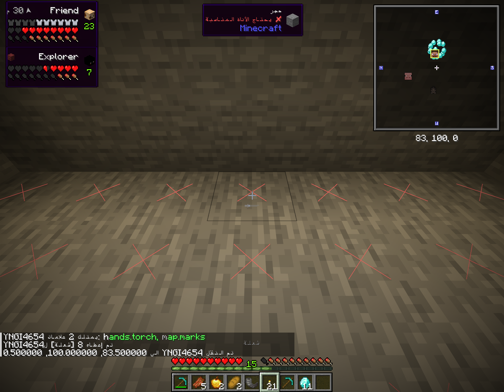

# Map

A minimap and a world map for [Horizon](https://playhorizon.dev) (Minecraft: Java Edition 26.3 in Rust), in Minecraft's own look: a bevelled minimap that turns with you, every creature as its own face, waypoints and death points, a full-screen world map of everywhere you have been. English and Arabic; Arabic mirrors every screen.

## What it shows
- **Minimap** (hold `H` to enlarge it): square or circle, rotating or north-locked, zoom 1–6, compass letters, the faces of nearby players, mobs and items (darker below you), waypoints (clamped to the edge when far), coordinates and optional biome, dimension, time and light.
- **World map** (`M`): explored ground on black, cursor coordinates and biome, zoom, waypoints as pennants, a right-click menu (create waypoint, teleport, share, export PNG) and a waypoint mini-menu.
- **Waypoints** (`N` for the list, `R` to create one here): list, create and edit screens, sets, sharing, death points.
- **With [Team](https://github.com/ameliiom/team)** (0.3 or later, optional): each teammate's face on both maps (on the edge of the minimap when far) and every ping as a pennant in its owner's colour, with a sword for danger and the block for loot.
- Cave view, chunk grid, slime chunks, light overlay, footsteps, PNG export, and import of Xaero's waypoints and settings.
- **Light marks in the world** (with [Skills](https://github.com/ameliiom/skills) 0.2.1 or later, optional): unlock **Spawn Sight** in the Mining tree, and while you hold a torch the light overlay's rule is drawn on the ground around you too: a red cross where the light is 0 (monsters spawn), yellow where it is still low. Same settings as the overlay (light source, min, max, colour); its own switch **Light marks in the world**.



## Map icons
Every creature on the maps has an icon of one size. Map draws it from the creature's own model: the front of its head with whatever stands on it. A resource pack or a mod can supply its own icon instead, for any entity of any namespace:

```
assets/<namespace>/textures/map/icons/<entity>.png
assets/<namespace>/textures/map/icons/<entity>/<variant>.png
```

`<entity>` is the entity type's path (`pig` for `minecraft:pig`, `frost_wolf` for `acme:frost_wolf`). `<variant>` is the name of the texture the entity is drawn with (`cold_cow`), and it is used first when it exists. Use a square image such as 8×8 or 16×16. Map scales it to the icon box and draws the black outline itself.

## Install
1. Copy `map.hmod` into `%APPDATA%\horizon\horizon-native-mods\`.
2. Add the line `mod.map:true` to `%APPDATA%\horizon\horizon-mods.txt`.
3. Build: in the launcher's Mods page press **Build**, or run `horizon-launcher native-build --instance horizon --trust-native-code`. Needs launcher 0.2.82 or later. A native mod runs with your rights: install it only from a source you trust.

Built for Horizon Nightly `f037744` (2026-11-21).

## Build
```powershell
cargo horizon-mod build
```
The source package is `target\horizon-mod\map.hmod`; the launcher compiles it (step 3 above).

## Licence
GPL-3.0-only, see [LICENSE](LICENSE) and [NOTICE](NOTICE). Adapted from [trail](https://github.com/groznen95/trailgrid) by groznen95, itself derived from Minimap, Worldmap and waypoints reworked by daniliammo and Gurov08ruS. Its look follows Xaero's Minimap and World Map, studied from the running mods; no code or assets from them are included. Not affiliated with Xaero or the Horizon project.
